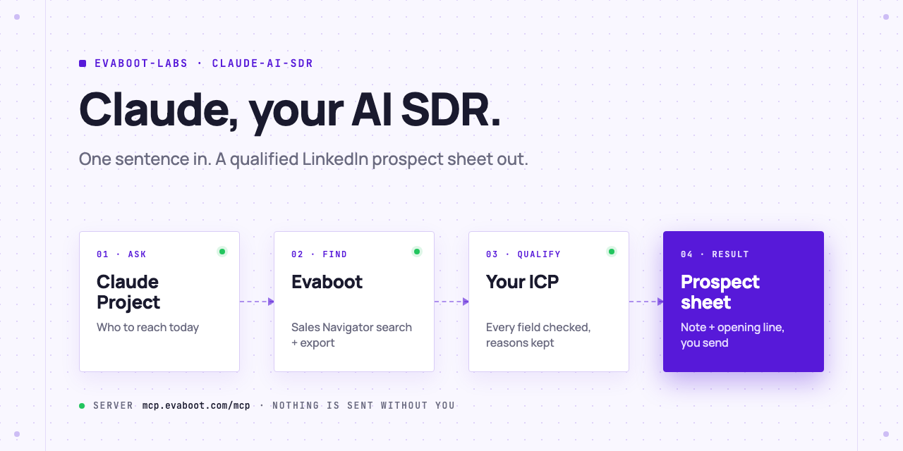
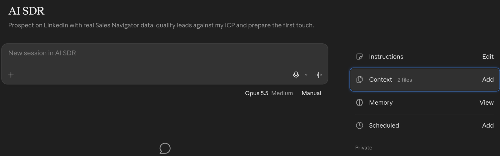
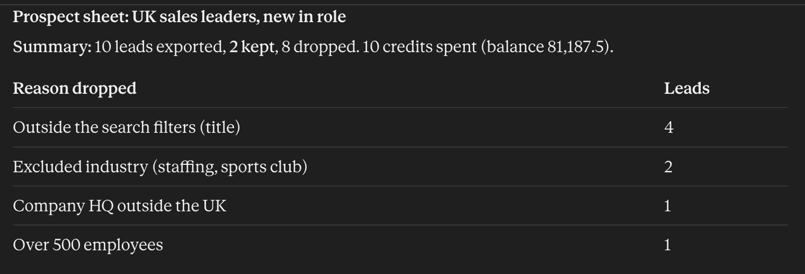
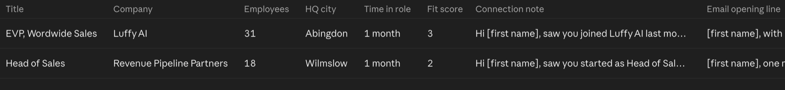

<picture>
  <source media="(prefers-color-scheme: dark)" srcset=".github/assets/banner-dark.png">
  
</picture>

# Claude AI SDR

Turn Claude into your SDR for one prospecting session. Describe who you want in one sentence: Claude builds the Sales Navigator search with Evaboot, exports a small batch with verified emails, checks every lead against your ICP, and hands back a prospect sheet with one LinkedIn connection note and one email opening line per qualified lead. You send.

[](AGENTS.md)
[](https://evaboot.com/mcp)
[](LICENSE)

## Set it up in one prompt

Paste this into Claude Code, Codex or Cursor:

```text
Clone https://github.com/evaboot-labs/claude-ai-sdr, read AGENTS.md and follow the skill. Find 10 Heads of Sales in the UK who changed jobs in the past 90 days.
```

Using the Claude app instead? Set it up as a Claude Project with [docs/claude-app.md](docs/claude-app.md).

<details>
<summary>Or install the skill</summary>

Claude Code:

```text
/plugin marketplace add evaboot-labs/claude-ai-sdr
/plugin install claude-ai-sdr@evaboot-labs-claude-ai-sdr
```

Codex, Cursor and other agents:

```bash
npx skills add evaboot-labs/claude-ai-sdr
```

</details>

## How it works

**1. One Claude Project, one session per chat.** The project holds the instructions, your ICP and your offer. The Evaboot connector does the Sales Navigator work.



**2. Every lead is checked, field by field.** Evaboot's own filter check, placeholder companies, HQ, company size and industry. Each dropped lead gets its reason.



**3. A prospect sheet you can act on.** Fit score, the reason, the channel, a connection note and an opening line per lead, as a table and a CSV. Nothing is sent.



## What you need

- An [Evaboot account](https://dash.evaboot.com/accounts/signup/?last_click_origin=claude-ai-sdr-repo) and a Sales Navigator seat.
- Claude (web, desktop or Claude Code) with the Evaboot connector, or Codex or Cursor with the MCP server.
- Cost: 1 Evaboot credit per exported lead, email included. Building the search is free.

## Go further

| Page | For |
|---|---|
| [docs/claude-app.md](docs/claude-app.md) | The Claude Project, the connector and the skill upload |
| [ICP.md](ICP.md) | Who fits, the hard rules and the fit score |
| [OFFER.md](OFFER.md) | What you sell and how the notes sound |
| [docs/connect-your-agent.md](docs/connect-your-agent.md) | The MCP server, by hand, for each agent |
| [docs/n8n.md](docs/n8n.md) | The same session as an n8n form |

---

Agents: start at [AGENTS.md](AGENTS.md) · Built by [Evaboot](https://evaboot.com) · More workflows at [github.com/evaboot-labs](https://github.com/evaboot-labs) · [MIT license](LICENSE)
